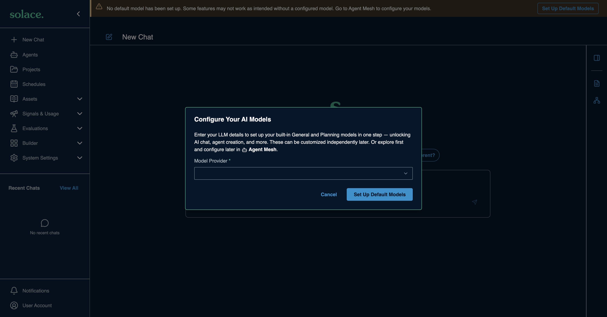
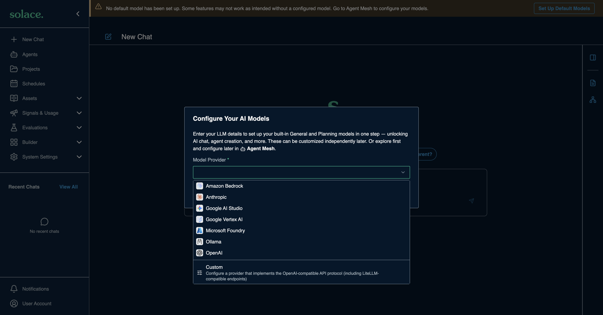
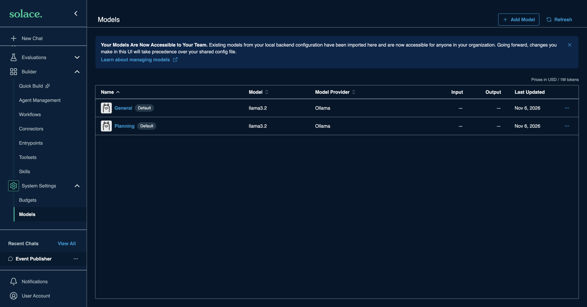
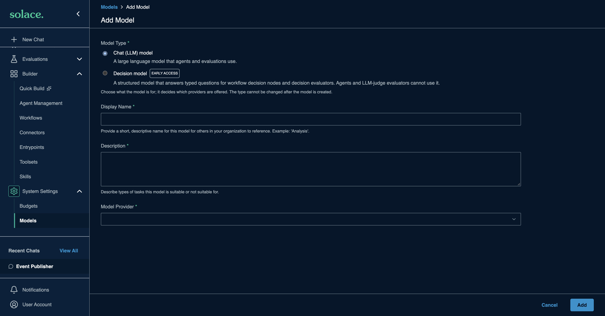

# Adding a model in SAM (System Settings > Models)

Every provider guide in this repo ends at this form. The provider page tells you
which values to paste; this page explains the form once.

> Source: [Configuring Models](https://docs.solace.com/Agent-Mesh/Framework/building/models/index.htm)
> (Solace docs). Last checked 2026-11-06.

## Two ways in

1. **First run.** A fresh SAM opens a **Configure Your AI Models** dialog the
   first time you open it in a browser. (Once closed, the **Set Up Default
   Models** banner button opens the Models page instead.) It asks only for the
   provider, its credentials and one model, and sets both built-in models,
   General and Planning, in one step. Easiest for a first setup.

   

   

2. **Models page.** **System Settings > Models** (in some SAM versions,
   **Builder > Models**). Use **Add Model** for extra models, or edit General or
   Planning.

   

## What each provider asks for in SAM

Captured from SAM 2.385.1 on 2026-11-06. Labels can differ slightly between versions.

| Model Provider | Authentication Type | Fields |
|---|---|---|
| Amazon Bedrock | AWS IAM | AWS Access Key ID, AWS Secret Access Key, AWS Session Token (optional), AWS Region |
| Anthropic | API Key | API Key |
| Google AI Studio | API Key | API Key |
| Google Vertex AI | GCP Service Account | Service Account JSON (paste the whole file), GCP Project ID, GCP Region |
| Microsoft Foundry (shown as **Azure OpenAI** in older versions) | API Key or OAuth2 | API Base URL, API Version (optional), Deployment Name |
| Ollama | None or API Key | API Base URL |
| OpenAI | API Key | API Key |
| Custom (OpenAI-compatible) | API Key, OAuth2 or None | API Base URL |

Choosing **OAuth2** (Custom, Microsoft Foundry) replaces the API Key field with
Token URL, Client ID, Client Secret and optional OAuth Scope, OAuth Audience,
CA Certificate Path, Token Refresh Buffer and Max Retries. That is for company
gateways; your platform team supplies the values.

Every provider then asks for a model (**Default Model**, or **Deployment Name**
for Foundry). The list fills in from the provider once the credentials work, so
an empty list usually means a credential problem.

## Before you start

- A *model configuration* tells SAM how to reach a model: the provider, the
  model name and the credentials. Agents never hold a provider or key; they
  refer to a configuration by its name (alias), so you can switch providers or
  models in one place.
- SAM ships with two built-in configurations, marked **Default**:
  - **General**: the model new agents and built-in AI features use.
  - **Planning**: the model the Orchestrator agent uses to plan and delegate work.

  They cannot be deleted and show as *not configured* until you connect them to
  a provider. You can point either one at a different provider or model later,
  and add more configurations with **Add Model**.
- Have your provider values ready (from the provider guide): an API key or
  credential, sometimes an API base URL, and a model name.

## The fields



| Field | What to enter |
|---|---|
| **Model Type** | **Chat (LLM) model** for agents. (Decision model is early access, for workflow decision nodes.) Cannot be changed later. |
| **Display Name** | The alias agents use, for example `general`, or a new name like `fast-chat`. |
| **Description** | What the model is good for. Other people in your org see this. |
| **Model Provider** | Pick your provider. Pick **Custom** for any OpenAI-compatible endpoint (OpenRouter, Groq, a LiteLLM proxy, and so on). |
| **API Base URL** | Only needed when the provider guide says so (Custom, Ollama, Azure, some cloud endpoints). |
| **Authentication Type** | Shown for **Custom** and **Ollama**: API Key, OAuth2, or None. Local servers usually use None. |
| **API Key** | Paste the key. Use the eye icon to check you pasted it fully. |
| **Model Name** | The dropdown fills in once the provider and key are valid. You can also type a name. |
| **Max Input Tokens** | Optional. The model's context window, from the provider's model page. |
| **Pricing** | Optional. USD per 1M input / output tokens, for cost reporting. |
| **Advanced Settings** | Temperature, Max Tokens, Prompt Caching Strategy, Custom Parameters. Leave defaults to start. |

Then click **Test Connection**. If it passes, click **Add** (or **Save**).
If it fails, read the error before choosing **Save Anyway**: most failures are a
wrong key, a wrong base URL, the wrong model name, or a model that cannot
call tools (Test Connection sends a short chat that includes a tool).

## Keep keys out of files you share

- In the UI, the key is stored by SAM; you never need to paste it anywhere else.
- In declarative config (`kind: model` YAML), reference keys as environment
  variables, for example `${OPENAI_API_KEY}`, and keep the value in `.env`.
- When editing `.env` in the workshop codespace, change only the key line and
  keep every path (such as `SAM_DATA_DIR`) **absolute**. A relative path breaks
  custom toolsets after a codespace restart.

## Declarative equivalent (optional)

```yaml
kind: model
metadata:
  name: general
spec:
  provider: openai            # anthropic, azure_openai, bedrock, google_ai_studio, vertex_ai, ollama, custom
  modelName: gpt-6.1-terra
  authConfig:
    type: apikey
    api_key: ${OPENAI_API_KEY}
```

Run `sam config schema show model` to see every accepted field. Reference:
[Configuring Models with the CLI](https://docs.solace.com/Agent-Mesh/Framework/building/models/cli.htm).
