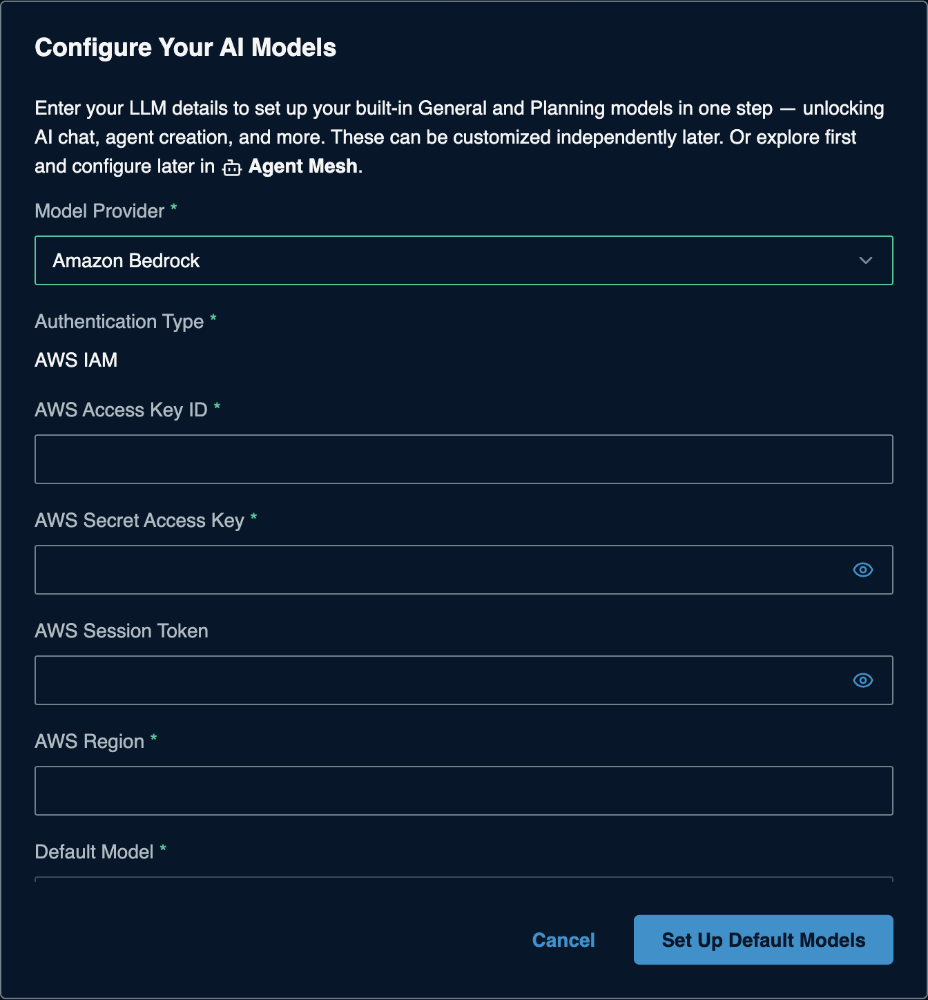

# Amazon Bedrock for Solace Agent Mesh

> **How this page was made.** The AWS-side steps below are based on AWS's
> official documentation, linked at each step. They were **not live-verified**
> by us (we did not use an AWS account). The AWS console changes often: if a
> screen looks different, follow the linked page.
> SAM-side steps were captured live from SAM 2.385.1. **Last checked: 2026-11-06.**

**Watch:** [Video 2: Cloud platforms](https://www.youtube.com/watch?v=0aBb9YDBepI&list=PLD2bQ9LWYU9M) ([transcript](../../videos/transcripts/02-cloud-providers.md))

## At a glance

| | |
|---|---|
| What you need | An AWS **access key ID** and **secret access key** for an IAM user allowed to call Bedrock, and a **Region** |
| Cost to start | AWS account with a payment method; pay per use |
| SAM Model Provider | **Amazon Bedrock** (Authentication Type **AWS IAM**) |
| API Base URL | Not asked |
| Example model names | `us.anthropic.claude-sonnet-4-6`, `us.openai.gpt-5.6-sol`, `openai.gpt-oss-120b` (IDs vary by Region; see the Bedrock **Model catalog**) |
| Time | About 15 minutes (plus up to 15 minutes for first use of a model) |

> **Note:** Bedrock also offers newer "Bedrock API keys" (bearer tokens).
> The SAM Bedrock provider asks for **IAM access keys**, so this guide uses those.

## Before you start

- An AWS account with a payment method: <https://portal.aws.amazon.com/billing/signup>.
- Permission in that account to create IAM users (or ask your AWS admin to
  hand you an access key with Bedrock permissions).
- Choose one **Region** where Bedrock and your model are available (for
  example `us-east-1`) and use it everywhere below.

## 1. Create an IAM user with Bedrock access

1. Open the **IAM** console, choose **Users > Create user**, and name it
   (for example `sam-bedrock`). It does not need console access.
2. On **Set permissions**, choose **Attach policies directly** and attach
   **AmazonBedrockLimitedAccess** (AWS managed policy for calling models).
3. Finish **Create user**.

CLI equivalent (from the AWS docs):

```bash
aws iam create-user --user-name sam-bedrock
aws iam attach-user-policy --user-name sam-bedrock \
  --policy-arn arn:aws:iam::aws:policy/AmazonBedrockLimitedAccess
```

(source: [Create an IAM user](https://docs.aws.amazon.com/IAM/latest/UserGuide/id_users_create.html),
[Bedrock API keys page, IAM policy example](https://docs.aws.amazon.com/bedrock/latest/userguide/api-keys.html))

## 2. Create an access key for that user

1. In IAM, open the user, go to the **Security credentials** tab.
2. Under **Access keys**, choose **Create access key**.
3. Pick the use case **Application running outside AWS** (or **Other**),
   then **Create access key**.
4. Copy the **Access key ID** and the **Secret access key**, or download the
   `.csv`. **The secret is shown only once.**

CLI: `aws iam create-access-key --user-name sam-bedrock`

(source: [Manage access keys for IAM users](https://docs.aws.amazon.com/IAM/latest/UserGuide/id_credentials_access-keys.html))

## 3. Make sure the model can be used

- In commercial Regions, Bedrock models are enabled automatically the first
  time you call them. The first call to a third-party model can take **up to 15
  minutes** while AWS sets up the subscription; until then you may see
  `AccessDeniedException`.
- **Anthropic (Claude) models** need a one-time **use case form** per account.
  Open Claude in the Bedrock **Model catalog** (or
  <https://console.aws.amazon.com/bedrock/home#/providers/anthropic>), fill in
  the form (a GitHub profile URL is fine as the website), and wait for it to be
  approved.

(source: [Access Amazon Bedrock foundation models](https://docs.aws.amazon.com/bedrock/latest/userguide/model-access.html),
[Getting started](https://docs.aws.amazon.com/bedrock/latest/userguide/getting-started.html))

## 4. Check the key works (optional)

With the [AWS CLI](https://docs.aws.amazon.com/cli/latest/userguide/getting-started-install.html):

```bash
export AWS_ACCESS_KEY_ID="AKIA...your-key-id..."
export AWS_SECRET_ACCESS_KEY="...your-secret..."
export AWS_REGION="us-east-1"
aws bedrock-runtime converse \
  --model-id us.anthropic.claude-sonnet-4-6 \
  --messages '[{"role":"user","content":[{"text":"Hello"}]}]'
```

A JSON reply with `output.message` means the key, Region and model all work.

(source: [Converse API](https://docs.aws.amazon.com/bedrock/latest/userguide/conversation-inference.html))

## 5. Add it to SAM

On a fresh SAM, the **Configure Your AI Models** dialog opens the first time you
open SAM in your browser. If you closed it, the **Set Up Default Models** button in
the banner takes you to **System Settings > Models** instead: edit **General**
(and **Planning**) there with the same values. Enter:

| Field | Value |
|---|---|
| Model Provider | **Amazon Bedrock** |
| Authentication Type | **AWS IAM** (preset) |
| AWS Access Key ID | from step 2 |
| AWS Secret Access Key | from step 2 |
| AWS Session Token | leave empty (only for temporary credentials) |
| AWS Region | the Region you chose, for example `us-east-1` |
| Default Model | pick from the list |



Click **Set Up Default Models**. Adding more models later:
[the SAM Models form](../../common/sam-model-form.md).

## Troubleshooting

| Symptom | Likely cause | Fix |
|---|---|---|
| `AccessDeniedException` on a new model | First-use subscription still running, or Anthropic form pending | Wait up to 15 minutes; check the form status in the Model catalog |
| `UnrecognizedClientException` / signature errors | Key ID or secret mistyped | Paste again; create a new access key if the secret was lost |
| Model list empty or model "not found" | Wrong Region, or model not offered there | Use a Region where the model is listed; some models need the `us.` / `global.` inference profile ID |
| `ValidationException` about on-demand throughput | Bare model ID used where an inference profile is required | Use the ID with a `us.` or `global.` prefix |

## Keep it safe

- This key belongs to an IAM user with only Bedrock access; never use your
  root or admin keys.
- Deactivate or delete the key under the user's **Security credentials** when
  you are done, and rotate it regularly.
- For production, AWS recommends roles or temporary credentials over long-lived
  access keys.

## References

- [Getting started with Amazon Bedrock](https://docs.aws.amazon.com/bedrock/latest/userguide/getting-started.html)
- [Access foundation models](https://docs.aws.amazon.com/bedrock/latest/userguide/model-access.html)
- [IAM access keys](https://docs.aws.amazon.com/IAM/latest/UserGuide/id_credentials_access-keys.html)
- [Create an IAM user](https://docs.aws.amazon.com/IAM/latest/UserGuide/id_users_create.html)
- [Bedrock pricing](https://aws.amazon.com/bedrock/pricing/)
