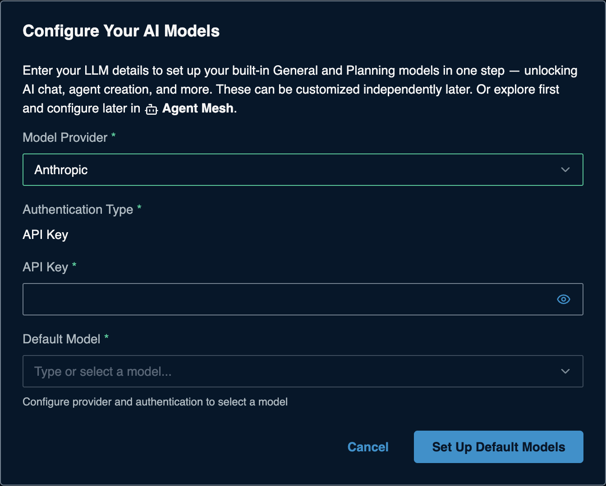

# Anthropic (Claude) for Solace Agent Mesh

> **How this page was made.** The Anthropic-side steps below are based on
> Anthropic's official documentation, linked at each step. They were **not
> live-verified** by us (we did not create an account). The Claude Console
> changes often: if a screen looks different, follow the linked page.
> SAM-side steps were captured live from SAM 2.385.1. **Last checked: 2026-11-06.**

**Watch:** [Video 1: API-key providers](https://www.youtube.com/watch?v=atnMfLbcSF4&list=PLD2bQ9LWYU9M) ([transcript](../../videos/transcripts/01-api-key-providers.md))

## At a glance

| | |
|---|---|
| What you need | A Claude API key (`sk-ant-api...`) |
| Cost to start | New accounts get a small amount of free credit; after that, prepaid credits |
| SAM Model Provider | **Anthropic** |
| API Base URL | Not asked |
| Example model names | `claude-haiku-5-5` (cheapest), `claude-sonnet-5-5`, `claude-opus-5-5` ([full list](https://platform.claude.com/docs/en/models/overview)) |
| Time | About 3 minutes |

## Before you start

- A Claude Console account: <https://platform.claude.com/>.
- Credits for more than light testing. Buy them under
  [Billing](https://platform.claude.com/settings/billing). See
  [Pricing](https://platform.claude.com/docs/en/about-claude/pricing).

## 1. Get your API key

1. Sign in to the Claude Console and open **API keys**:
   <https://platform.claude.com/settings/keys>.
2. Click **Create key**.
3. Give it a name (for example `sam-workshop`) and pick an **expiration**.
   The expiration cannot be changed later; a short one is safer for a workshop.
4. **Scope the key to a workspace** if offered. Keys without a workspace need
   an extra header on every call, which SAM does not send.
5. Create the key and **copy it right away**. Treat it as shown only once.

(source: [Authentication](https://platform.claude.com/docs/en/manage-claude/authentication),
[Get started](https://platform.claude.com/docs/en/get-started))

## 2. Check the key works (optional)

```bash
export ANTHROPIC_API_KEY="sk-ant-...your-key..."
curl https://api.anthropic.com/v1/messages \
  -H "x-api-key: $ANTHROPIC_API_KEY" \
  -H "anthropic-version: 2026-10-21" \
  -H "content-type: application/json" \
  -d '{"model": "claude-haiku-5-5", "max_tokens": 50, "messages": [{"role": "user", "content": "Hello"}]}'
```

A JSON reply with `"type": "message"` means the key works. This uses a tiny
amount of credit.

(source: [Get started](https://platform.claude.com/docs/en/get-started))

## 3. Add it to SAM

On a fresh SAM, the **Configure Your AI Models** dialog opens the first time you
open SAM in your browser. If you closed it, the **Set Up Default Models** button in
the banner takes you to **System Settings > Models** instead: edit **General**
(and **Planning**) there with the same values. Enter:

| Field | Value |
|---|---|
| Model Provider | **Anthropic** |
| Authentication Type | **API Key** (preset) |
| API Key | your `sk-ant-...` key |
| Default Model | pick from the list, for example `claude-sonnet-5-5` |



Click **Set Up Default Models**. Adding more models later:
[the SAM Models form](../../common/sam-model-form.md).

## Troubleshooting

| Symptom | Likely cause | Fix |
|---|---|---|
| `401` / model list stays empty | Key wrong, truncated, or expired | Paste again; expired keys cannot be renewed, create a new one |
| `400` mentioning workspace | Key not scoped to a workspace | Create a new key scoped to a workspace |
| `429` with `enforced_spend_limit_reached` | Monthly spend limit reached | Raise the limit or wait for the next month |
| Low rate limits | New organizations start on a low tier | See [Rate limits](https://platform.claude.com/docs/en/api/rate-limits) |

## Keep it safe

- Delete a key on the same **API keys** page.
- Keep it in SAM or `.env`, never in a file you commit or share.

## References

- [Get started](https://platform.claude.com/docs/en/get-started)
- [Authentication and API keys](https://platform.claude.com/docs/en/manage-claude/authentication)
- [Models overview](https://platform.claude.com/docs/en/models/overview)
- [Pricing](https://platform.claude.com/docs/en/about-claude/pricing)
- [Rate limits](https://platform.claude.com/docs/en/api/rate-limits)
