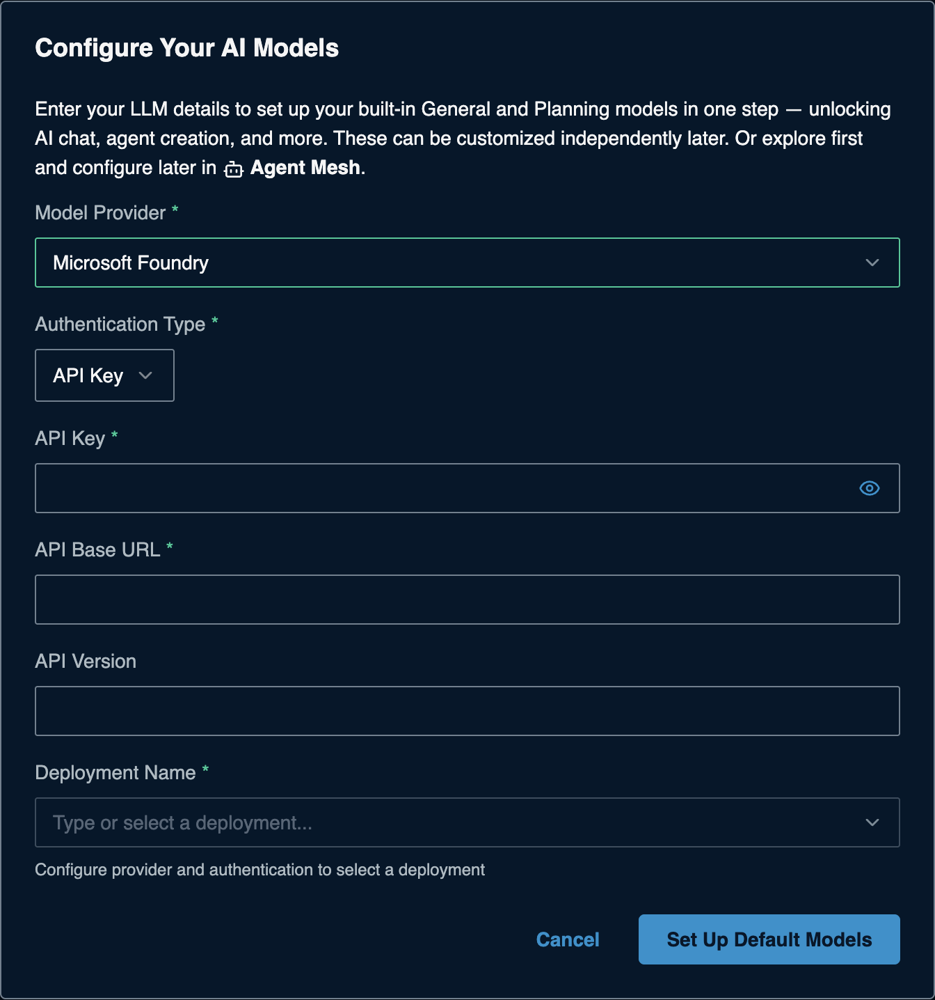

# Azure OpenAI (Microsoft Foundry) for Solace Agent Mesh

> **How this page was made.** The Azure-side steps below are based on
> Microsoft's official documentation, linked at each step. They were **not
> live-verified** by us (we did not use an Azure subscription). Azure is moving
> Azure OpenAI into **Microsoft Foundry** and both portals change often: if a
> screen looks different, follow the linked page.
> SAM-side steps were captured live from SAM 2.385.1. **Last checked: 2026-11-06.**

**Watch:** [Video 2: Cloud platforms](https://www.youtube.com/watch?v=0aBb9YDBepI&list=PLD2bQ9LWYU9M) ([transcript](../../videos/transcripts/02-cloud-providers.md))

## At a glance

| | |
|---|---|
| What you need | **Endpoint** (API Base URL), **API key**, and a **deployment name** |
| Cost to start | Azure subscription with billing; pay per use |
| SAM Model Provider | **Microsoft Foundry** (shown as **Azure OpenAI** in older SAM versions) |
| API Base URL | Your resource endpoint, for example `https://YOUR-RESOURCE.openai.azure.com/` |
| Example models to deploy | `gpt-5-mini`, `gpt-5.4-mini`, `gpt-5.5` (availability varies by Region) |
| Time | About 15 minutes |

> **The number one mistake:** SAM needs your **deployment name** (the name you
> give the model when you deploy it), not the model name. They can differ.

## Before you start

- An Azure subscription: <https://azure.microsoft.com/pricing/purchase-options/azure-account>.
- A role that can create resources in a resource group (for example
  Contributor), or an admin who creates the resource for you.
- A Region where your chosen model has quota.

## 1. Create an Azure OpenAI resource

1. In the [Azure portal](https://portal.azure.com), select **Create a resource**,
   search for **Azure OpenAI**, and select **Create**.
2. On **Basics**, fill in **Subscription**, **Resource group**, **Region**,
   **Name**, and **Pricing tier** (Standard). Select **Next**.
3. On **Network**, keep **All networks** for a first try. Continue to
   **Review + submit**, then **Create**, then **Go to resource**.

If the portal offers to upgrade the resource to a Foundry resource, either
choice works with SAM.

(source: [Create and deploy an Azure OpenAI resource](https://learn.microsoft.com/en-us/azure/ai-foundry/openai/how-to/create-resource))

## 2. Deploy a model

1. Open the [Foundry portal](https://ai.azure.com) and select your resource.
2. Go to **Deployments > + Deploy model > Deploy base model**.
3. Pick a model (for example `gpt-5-mini`) and **Confirm**.
4. Set the **Deployment name** (write it down) and a **Deployment type**
   (for example Global Standard), then **Deploy**.

(source: [Create and deploy an Azure OpenAI resource](https://learn.microsoft.com/en-us/azure/ai-foundry/openai/how-to/create-resource);
new portal: [Foundry quickstart](https://learn.microsoft.com/en-us/azure/foundry/tutorials/quickstart-create-foundry-resources))

## 3. Copy the endpoint and key

1. Back in the Azure portal, open your resource.
2. Under **Resource Management > Keys and Endpoint**, copy the **Endpoint**
   and **KEY 1** (KEY 2 is a spare for rotation).

CLI: `az cognitiveservices account keys list --name <resource> --resource-group <group>`

(source: [Create and deploy an Azure OpenAI resource](https://learn.microsoft.com/en-us/azure/ai-foundry/openai/how-to/create-resource))

## 4. Check the key works (optional)

```bash
export AZURE_OPENAI_API_KEY="...your-key..."
curl -X POST "https://YOUR-RESOURCE.openai.azure.com/openai/v1/responses" \
  -H "Content-Type: application/json" \
  -H "api-key: $AZURE_OPENAI_API_KEY" \
  -d '{"model": "YOUR-DEPLOYMENT-NAME", "input": "This is a test."}'
```

A JSON reply with `output` means the endpoint, key and deployment work.

(source: [Azure OpenAI quickstart](https://learn.microsoft.com/en-us/azure/ai-foundry/openai/quickstart),
[v1 API](https://learn.microsoft.com/en-us/azure/ai-foundry/openai/api-version-lifecycle))

## 5. Add it to SAM

On a fresh SAM, the **Configure Your AI Models** dialog opens the first time you
open SAM in your browser. If you closed it, the **Set Up Default Models** button in
the banner takes you to **System Settings > Models** instead: edit **General**
(and **Planning**) there with the same values. Enter:

| Field | Value |
|---|---|
| Model Provider | **Microsoft Foundry** (or **Azure OpenAI**) |
| Authentication Type | **API Key** |
| API Base URL | the **Endpoint** from step 3, exactly as shown, for example `https://YOUR-RESOURCE.openai.azure.com/`. **Do not add** `/openai/v1` or any other path. |
| API Key | **KEY 1** |
| API Version | leave empty (SAM uses a default) unless your admin gives you one |
| Deployment Name | **type** your deployment name from step 2. The list may stay empty. |

> **What SAM sends (checked live, SAM 2.385.1, against a local test server):**
> SAM builds the request path itself, for example
> `<API Base URL>/openai/deployments/<Deployment Name>/chat/completions?api-version=2024-10-21`,
> and sends the key as an `api-key` header. That is why the API Base URL must
> be the bare resource endpoint: an endpoint ending in `/openai/v1/` turns into
> `/openai/v1/openai/deployments/...` and fails. We could not test against a
> real Azure resource; SAM's log notes that it may use a different route for
> real Azure hosts, but the bare endpoint is what it expects either way.



Click **Set Up Default Models**. Adding more models later:
[the SAM Models form](../../common/sam-model-form.md).

## Troubleshooting

| Symptom | Likely cause | Fix |
|---|---|---|
| `DeploymentNotFound` / 404 | Model name used instead of deployment name, or deployment still creating | Use the exact deployment name; wait a minute after deploying |
| `401 Access denied` | Wrong key, or key from another resource | Copy KEY 1 from this resource's **Keys and Endpoint** |
| `404` on Test Connection | API Base URL has an extra path (`/openai/v1/`, a project URL) | Use only `https://YOUR-RESOURCE.openai.azure.com/` |
| Deployment Name is greyed out | API Key or API Base URL not filled yet | Fill both first; the field unlocks once they are set |
| Deployment list empty | Normal in some setups | Type the deployment name; if Test Connection then fails, re-check endpoint and key |
| `429` / quota errors | Region or subscription quota | Lower usage, or deploy in another Region |
| Errors about `api-version` | Older endpoint style | Enter an API version your admin or the docs give, or use the endpoint above |

## Keep it safe

- Regenerate KEY 1 or KEY 2 under **Keys and Endpoint** to revoke a leaked key
  (switch SAM to the other key first).
- For production, Microsoft recommends Microsoft Entra ID (keyless) over keys;
  SAM also offers OAuth2 for this provider.

## References

- [Create and deploy an Azure OpenAI resource](https://learn.microsoft.com/en-us/azure/ai-foundry/openai/how-to/create-resource)
- [Foundry quickstart (new portal)](https://learn.microsoft.com/en-us/azure/foundry/tutorials/quickstart-create-foundry-resources)
- [Endpoints](https://learn.microsoft.com/en-us/azure/foundry/foundry-models/concepts/endpoints)
- [v1 API and versions](https://learn.microsoft.com/en-us/azure/ai-foundry/openai/api-version-lifecycle)
- [Pricing](https://azure.microsoft.com/pricing/details/cognitive-services/openai-service/)
