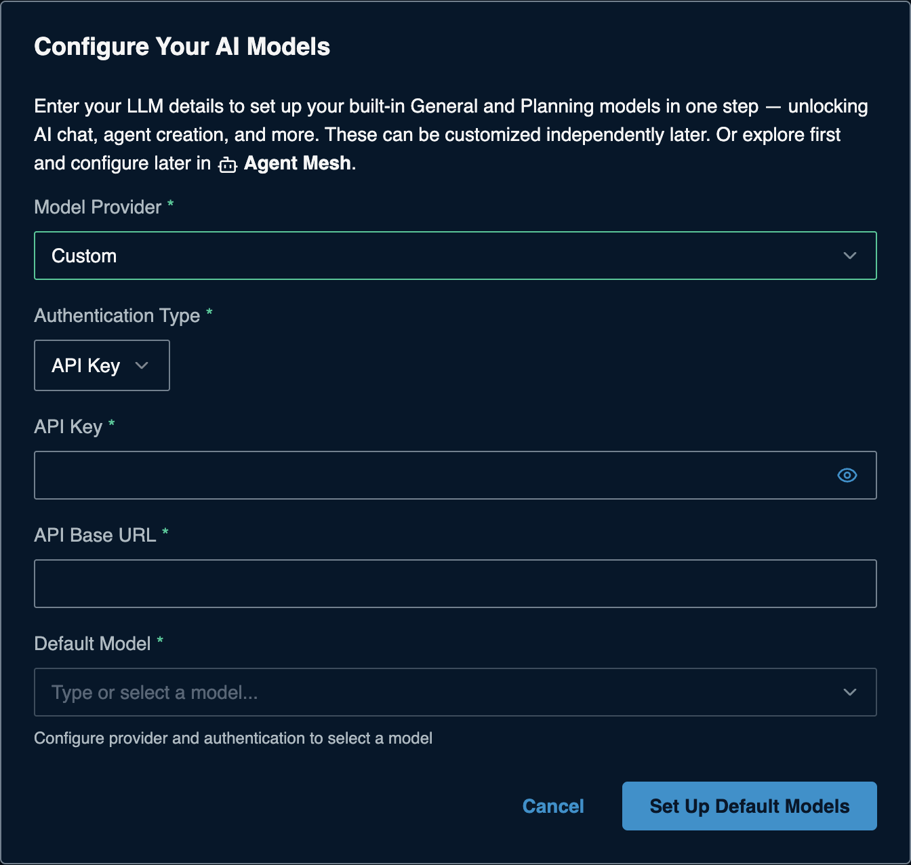
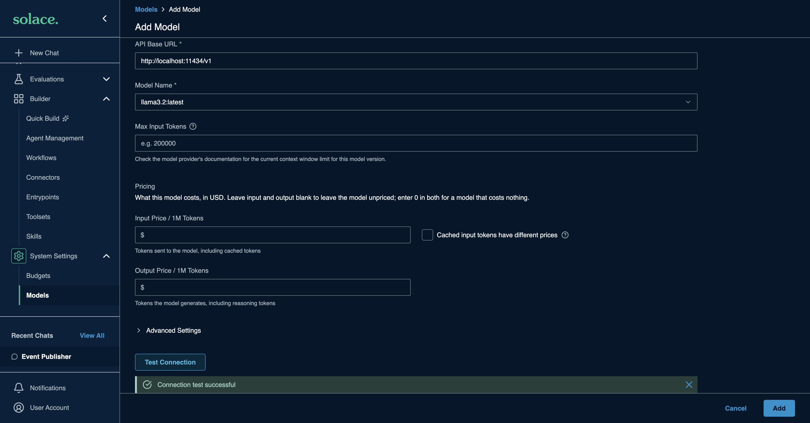

# Custom (OpenAI-compatible) providers for Solace Agent Mesh

Many providers and self-hosted servers speak the OpenAI API. In SAM they all
use the **Custom** provider, and you only need three things: an **API Base
URL**, an **API key** (sometimes none), and a **model name**.

> **How this page was made.** Base URLs, key pages and model names come from
> each provider's official documentation, linked in the table. They were **not
> live-verified** by us (we did not create accounts). Model names change often;
> check the provider's model list. SAM-side steps were captured live from
> SAM 2.385.1. **Last checked: 2026-11-06.**

**Watch:** [Video 4: Any OpenAI-compatible provider](https://www.youtube.com/watch?v=cj9DlIAHXi0&list=PLD2bQ9LWYU9M) ([transcript](../../videos/transcripts/04-custom-provider.md))

## Add it to SAM (same for every provider)

On a fresh SAM, the **Configure Your AI Models** dialog opens the first time you
open SAM in your browser. If you closed it, the **Set Up Default Models** button in
the banner takes you to **System Settings > Models** instead: edit **General**
(and **Planning**) there with the same values. Enter:

| Field | Value |
|---|---|
| Model Provider | **Custom** |
| Authentication Type | **API Key** (hosted providers) or **None** (local servers without a key) |
| API Base URL | from the table below. SAM adds `/v1` if it is missing, so `https://host` and `https://host/v1` both work. If your provider's chat address does not follow that pattern, paste the **full** URL ending in `/chat/completions` (see [Non-standard chat URLs](#non-standard-chat-urls)) |
| API Key | your provider key |
| Default Model | pick from the list, or type the provider's model name |



Click **Set Up Default Models**. Adding more models later:
[the SAM Models form](../../common/sam-model-form.md).

**What SAM sends (checked live, SAM 2.385.1):** it lists models with
`GET <base>/v1/models` and chats with `POST <base>/v1/chat/completions`, with
your key as `Authorization: Bearer ...`. **Test Connection** sends a short chat
**that includes a tool**, so it also checks that the model can call tools. We
verified the whole Custom path end to end against a local OpenAI-compatible
server (Ollama's `/v1` endpoint): models listed, **Connection test successful**.



### Non-standard chat URLs

Some providers do not serve chat at `<base>/v1/chat/completions`. Volcengine Ark,
for example, uses `/api/v3/chat/completions`, so adding `/v1` would break it.
SAM releases newer than 2.385.1 handle this: **if the API Base URL ends in
`/chat/completions`, SAM uses it exactly as typed** and does not add anything.

- Copy the full chat completions URL from the provider's docs, for example
  `https://ark.cn-beijing.volces.com/api/v3/chat/completions`.
- If the **Default Model** list stays empty, type the provider's model name
  yourself (for Ark, the model or endpoint ID from its console).
- Then click **Test Connection** as usual.
- On SAM 2.385.1 and older, a full URL is not recognized; upgrade SAM first.

Not live-verified by us: this behavior comes from the SAM developers and was
not yet tested against a released build.

## Hosted providers

| Provider | API Base URL | Get a key | Example model | Notes |
|---|---|---|---|---|
| [OpenRouter](https://openrouter.ai/docs/quickstart) | `https://openrouter.ai/api/v1` | [openrouter.ai/keys](https://openrouter.ai/keys) | `~anthropic/claude-sonnet-latest` | One key, hundreds of models. Some `:free` models (low daily limits, [limits](https://openrouter.ai/docs/api-reference/limits)) |
| [Groq](https://console.groq.com/docs/openai) | `https://api.groq.com/openai/v1` | [console.groq.com/keys](https://console.groq.com/keys) | `llama-3.3-70b-versatile` | Free plan with [rate limits](https://console.groq.com/docs/rate-limits); very fast |
| [Together AI](https://docs.together.ai/docs/openai-api-compatibility) | `https://api.together.ai/v1` | [API keys](https://api.together.ai/settings/projects/~current/api-keys) | `openai/gpt-oss-120b` | Use Together's model names; OpenAI names return 404 |
| [Fireworks AI](https://docs.fireworks.ai/tools-sdks/openai-compatibility) | `https://api.fireworks.ai/inference/v1` | [API keys](https://app.fireworks.ai/settings/users/api-keys) | `accounts/fireworks/models/...` | Model names are full paths |
| [Mistral](https://docs.mistral.ai/api) | `https://api.mistral.ai/v1` | [console.mistral.ai/api-keys](https://console.mistral.ai/api-keys) | `mistral-small-latest` | Needs a plan with API access ([setup](https://docs.mistral.ai/getting-started/quickstarts/studio/activate-and-generate-api-key)) |
| [DeepSeek](https://api-docs.deepseek.com/) | `https://api.deepseek.com` | [platform.deepseek.com/api_keys](https://platform.deepseek.com/api_keys) | `deepseek-v4-pro` | Prepaid balance |
| [xAI (Grok)](https://docs.x.ai/docs/tutorial) | `https://api.x.ai/v1` | [console.x.ai](https://console.x.ai/team/default/api-keys) | `grok-4.7` | Needs credits loaded |
| [Volcengine Ark](https://www.volcengine.com/docs/82379/1330626) | `https://ark.cn-beijing.volces.com/api/v3/chat/completions` (full URL, see [above](#non-standard-chat-urls)) | Ark console (see [Ark's docs](https://www.volcengine.com/docs/82379/1330626)) | the model or endpoint ID from the Ark console | Needs a SAM release newer than 2.385.1; the model list may stay empty, so type the name. The host shown is the Beijing region; use the one your docs give |
| [Cerebras](https://inference-docs.cerebras.ai/quickstart) | `https://api.cerebras.ai/v1` | [cloud.cerebras.ai](https://cloud.cerebras.ai) > API Keys | `gpt-oss-120b` | Free account tier; SAM lists it as not tested end to end |

**Perplexity** has an OpenAI-style API (`https://api.perplexity.ai/orchestrator/v1`), but its
Sonar chat-completions support ended on 2026-09-27 and tool calling is not documented.
SAM agents rely on tool calling, so check its current docs before using it as a SAM model
([docs](https://docs.perplexity.ai/getting-started/quickstart)).

## Self-hosted servers

| Server | API Base URL | Key | Model name | Notes |
|---|---|---|---|---|
| [LiteLLM proxy](https://docs.litellm.ai/docs/proxy/docker_quick_start) | `http://localhost:4000` | a **virtual key** from the admin UI (`/ui` > Virtual Keys) | the `model_name` in your `config.yaml` | Never hand out the master key |
| [vLLM](https://docs.vllm.ai/en/latest/serving/online_serving/openai_compatible_server/) | `http://localhost:8000/v1` | whatever you pass to `vllm serve --api-key`, or Authentication Type **None** | the model you serve | Tool calling needs server flags such as `--enable-auto-tool-choice` |
| [LM Studio](https://lmstudio.ai/docs/developer/openai-compat) | `http://localhost:1234/v1` | none by default (Authentication Type **None**) | the loaded model's ID | Start the server in the Developer tab or `lms server start` |
| [Ollama](../ollama/README.md) | | | | Has its own provider in SAM; see its page |

For local servers, `localhost` must be reachable **from SAM**: if SAM runs in
Docker use `host.docker.internal`, and from a GitHub Codespace your laptop is
not reachable at all. See the table in the [Ollama guide](../ollama/README.md#where-is-sam-running).

## Check any provider (optional)

```bash
# list models (cheap key check, where supported)
curl BASE_URL/models -H "Authorization: Bearer sk-...your-key..."

# one chat call
curl BASE_URL/chat/completions \
  -H "Authorization: Bearer sk-...your-key..." \
  -H "Content-Type: application/json" \
  -d '{"model": "MODEL", "messages": [{"role": "user", "content": "Say hello"}]}'
```

Replace `BASE_URL` with the API Base URL from the table (it already ends in `/v1`
where needed). If you use a full chat URL, call that URL directly for the chat
check; the model list call may not exist for that provider.

## Choosing a model for SAM

- SAM agents **call tools**. Pick a model the provider documents as supporting
  tool or function calling; models without it answer poorly or loop.
- Bigger context windows help with long agent runs. Set **Max Input Tokens** on
  the Models page to the provider's documented limit.

## Troubleshooting

| Symptom | Likely cause | Fix |
|---|---|---|
| `404 Not Found` | Base URL has an extra path the provider does not expect, or the provider's chat address is not `<base>/v1/chat/completions` | Use the URL exactly as in the table; for a non-standard provider, paste the full URL ending in `/chat/completions` |
| Test Connection fails but curl works | Model does not support tool calling | Choose a model that supports tools |
| `401 Unauthorized` | Wrong key or wrong provider's key | Paste again; check the key page |
| Model list empty | Provider has no model list endpoint, or key rejected | Type the model name directly; check the key with curl |
| `400` errors about parameters | Provider does not support an OpenAI option (for example `n` > 1, logprobs) | Remove custom parameters under **Advanced Settings** |
| Agent never calls tools | Model lacks tool calling | Choose a model that supports it |

## References

Provider documentation is linked in each table row. SAM docs:
[Configuring Models](https://docs.solace.com/Agent-Mesh/Framework/building/models/index.htm),
[provider prefixes](https://docs.solace.com/Agent-Mesh/Framework/installing/configure.htm).
