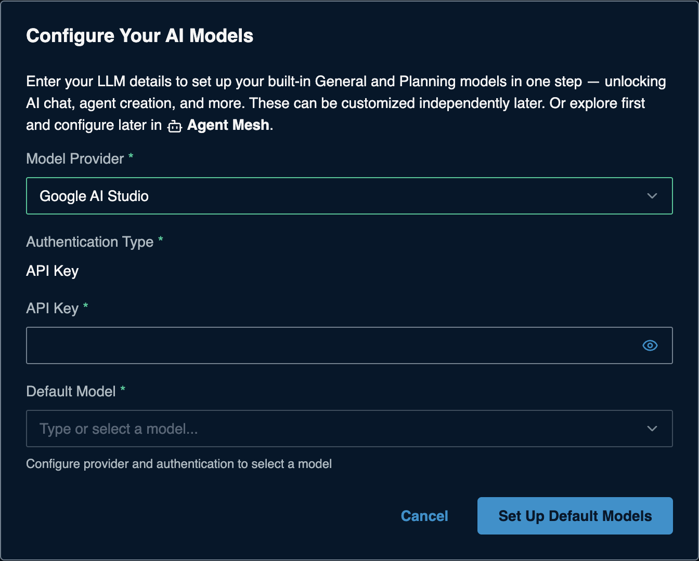

# Google AI Studio (Gemini API) for Solace Agent Mesh

> **How this page was made.** The Google-side steps below are based on Google's
> official documentation, linked at each step. They were **not live-verified**
> by us (we did not create a key). AI Studio changes often: if a screen looks
> different, follow the linked page.
> SAM-side steps were captured live from SAM 2.385.1. **Last checked: 2026-11-06.**

**Watch:** [Video 1: API-key providers](https://www.youtube.com/watch?v=atnMfLbcSF4&list=PLD2bQ9LWYU9M) ([transcript](../../videos/transcripts/01-api-key-providers.md))

## At a glance

| | |
|---|---|
| What you need | A Gemini API key |
| Cost to start | **Free tier** with a Google account (rate-limited) |
| SAM Model Provider | **Google AI Studio** |
| API Base URL | Not asked |
| Example model names | `gemini-3.8-flash`, `gemini-3.6-flash`, `gemini-3.5-flash-lite` ([full list](https://aistudio.google.com/docs/models)) |
| Time | About 2 minutes |

## Before you start

- A Google account.
- On the free tier, Google may use your prompts and responses to improve its
  products. Do not send confidential data on the free tier. See
  [Pricing](https://aistudio.google.com/docs/pricing).

## 1. Get your API key

1. Open <https://aistudio.google.com/apikey> and sign in.
2. Click **Create API key** and copy it.
3. If no project is shown or the button is disabled, go to **Dashboard >
   Projects > Import projects**, import a Google Cloud project, then create
   the key again.
4. If you see *"You do not have permission to create a key in this project"*,
   ask the project owner for the Editor role, or use a personal project.
5. If AI Studio offers **Add restrictions**, choose **Restrict to Gemini API
   only**. Unrestricted keys may be rejected or blocked later.

(source: [Using Gemini API keys](https://aistudio.google.com/docs/api-key))

## 2. Check the key works (optional)

```bash
export GEMINI_API_KEY="...your-key..."
curl "https://generativelanguage.googleapis.com/v1beta/openai/chat/completions" \
  -H "Content-Type: application/json" \
  -H "Authorization: Bearer $GEMINI_API_KEY" \
  -d '{"model": "gemini-3.8-flash", "messages": [{"role": "user", "content": "Say hello"}]}'
```

A JSON reply with a `choices` list means the key works.

(source: [OpenAI compatibility](https://aistudio.google.com/docs/openai))

## 3. Add it to SAM

On a fresh SAM, the **Configure Your AI Models** dialog opens the first time you
open SAM in your browser. If you closed it, the **Set Up Default Models** button in
the banner takes you to **System Settings > Models** instead: edit **General**
(and **Planning**) there with the same values. Enter:

| Field | Value |
|---|---|
| Model Provider | **Google AI Studio** |
| Authentication Type | **API Key** (preset) |
| API Key | your Gemini key |
| Default Model | pick from the list, for example `gemini-3.8-flash` |



Click **Set Up Default Models**. Adding more models later:
[the SAM Models form](../../common/sam-model-form.md).

## Troubleshooting

| Symptom | Likely cause | Fix |
|---|---|---|
| Model list stays empty / `400 API key not valid` | Key mistyped or restricted to another API | Paste again; check the key's restrictions include the Gemini API |
| `429 RESOURCE_EXHAUSTED` | Free-tier rate limit hit | Wait a minute, pick a lighter model, or enable billing. Limits are shown in AI Studio ([Rate limits](https://aistudio.google.com/docs/rate-limits)) |
| Key shows **Blocked** | Unrestricted key that went unused | Create a new key restricted to the Gemini API |
| Model not found | Older model retired (2.5 models are deprecated) | Pick a current model from the list |

## Keep it safe

- Delete keys on the same **API keys** page in AI Studio.
- Keep it in SAM or `.env`, never in a file you commit or share.

## References

- [Using Gemini API keys](https://aistudio.google.com/docs/api-key)
- [OpenAI compatibility](https://aistudio.google.com/docs/openai)
- [Models](https://aistudio.google.com/docs/models)
- [Pricing](https://aistudio.google.com/docs/pricing)
- [Rate limits](https://aistudio.google.com/docs/rate-limits)
