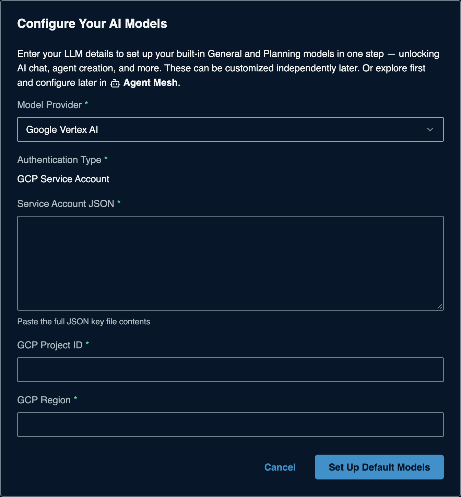

# Google Vertex AI for Solace Agent Mesh

> **How this page was made.** The Google Cloud steps below are based on
> Google's official documentation, linked at each step. They were **not
> live-verified** by us (we did not use a Google Cloud project). Google now
> calls Vertex AI's generative side **Gemini Enterprise Agent Platform**, and
> console labels change often: if a screen looks different, follow the linked page.
> SAM-side steps were captured live from SAM 2.385.1. **Last checked: 2026-11-06.**

**Watch:** [Video 2: Cloud platforms](https://www.youtube.com/watch?v=0aBb9YDBepI&list=PLD2bQ9LWYU9M) ([transcript](../../videos/transcripts/02-cloud-providers.md))

## At a glance

| | |
|---|---|
| What you need | A **service account JSON key**, your **project ID**, and a **region** |
| Cost to start | Google Cloud project with billing (new accounts get a trial credit; a card is required) |
| SAM Model Provider | **Google Vertex AI** (Authentication Type **GCP Service Account**) |
| API Base URL | Not asked |
| Example model names | `gemini-3.5-flash`, `gemini-3-flash-preview` |
| Region | `global` or a specific one such as `us-central1` |
| Time | About 15 minutes |

Want Gemini without a cloud project? Use [Google AI Studio](../google-ai-studio/README.md).

> **Company accounts:** many Google Cloud organizations block service account
> key creation (policy `iam.disableServiceAccountKeyCreation`, on by default
> for organizations created since May 2024). If **Add key** is greyed out or
> fails, ask your cloud admin.

## Before you start

- A Google Cloud project with **billing enabled**. Trial details:
  [Free cloud features](https://docs.cloud.google.com/free/docs/free-cloud-features).
- Permission to enable APIs, create service accounts, and grant roles in that
  project (Owner or an equivalent admin role).

## 1. Enable the API

In the Google Cloud console, select your project and enable the
**Agent Platform API** (formerly Vertex AI API):
<https://console.cloud.google.com/agent-platform/overview>.

CLI: `gcloud services enable aiplatform.googleapis.com`

(source: [Quickstart](https://docs.cloud.google.com/vertex-ai/generative-ai/docs/start/quickstart))

## 2. Create a service account with access

1. Go to **IAM & Admin > Service accounts > Create service account**, name it
   (for example `sam-vertex`), and create it.
2. Grant it the role **Agent Platform User** (`roles/aiplatform.user`).

CLI:

```bash
gcloud iam service-accounts create sam-vertex --project=YOUR_PROJECT_ID
gcloud projects add-iam-policy-binding YOUR_PROJECT_ID \
  --member="serviceAccount:sam-vertex@YOUR_PROJECT_ID.iam.gserviceaccount.com" \
  --role="roles/aiplatform.user"
```

(source: [Quickstart](https://docs.cloud.google.com/vertex-ai/generative-ai/docs/start/quickstart))

## 3. Create the JSON key

1. In **Service accounts**, click the account's email, then the **Keys** tab.
2. Choose **Add key > Create new key > JSON > Create**. A `.json` file downloads.
   **You cannot download it again**; keep it somewhere safe.

CLI: `gcloud iam service-accounts keys create sam-vertex-key.json --iam-account=sam-vertex@YOUR_PROJECT_ID.iam.gserviceaccount.com`

(source: [Create and delete service account keys](https://docs.cloud.google.com/iam/docs/keys-create-delete))

## 4. Check it works (optional)

```bash
gcloud auth activate-service-account --key-file=sam-vertex-key.json
curl -X POST -H "Content-Type: application/json" \
  -H "Authorization: Bearer $(gcloud auth print-access-token)" \
  "https://aiplatform.googleapis.com/v1/projects/YOUR_PROJECT_ID/locations/global/publishers/google/models/gemini-3.5-flash:generateContent" \
  -d '{"contents": {"role": "user", "parts": {"text": "Say hello"}}}'
```

A JSON reply with `candidates` means the key, project and API all work.

(source: [Quickstart](https://docs.cloud.google.com/vertex-ai/generative-ai/docs/start/quickstart))

## 5. Add it to SAM

On a fresh SAM, the **Configure Your AI Models** dialog opens the first time you
open SAM in your browser. If you closed it, the **Set Up Default Models** button in
the banner takes you to **System Settings > Models** instead: edit **General**
(and **Planning**) there with the same values. Enter:

| Field | Value |
|---|---|
| Model Provider | **Google Vertex AI** |
| Authentication Type | **GCP Service Account** (preset) |
| Service Account JSON | open the `.json` file and paste **its whole contents** |
| GCP Project ID | your project ID (not the project name) |
| GCP Region | `global`, or the region you use, for example `us-central1` |
| Default Model | pick from the list, for example `gemini-3.5-flash` |



Click **Set Up Default Models**. Adding more models later:
[the SAM Models form](../../common/sam-model-form.md).

## Troubleshooting

| Symptom | Likely cause | Fix |
|---|---|---|
| `PERMISSION_DENIED` | Role missing, or API not enabled | Grant `roles/aiplatform.user`; enable the API in step 1 |
| Cannot create a key | Organization policy blocks key creation | Ask your admin for an exception, or use [Google AI Studio](../google-ai-studio/README.md) |
| Invalid JSON / credentials error | Only part of the file pasted | Paste the full file, from the first `{` to the last `}` |
| Model not found | Model not offered in that region | Try `global`, or check the model's regions |
| Billing errors | Billing not enabled on the project | Link a billing account to the project |

## Keep it safe

- The JSON key never expires by default. Delete it under the service account's
  **Keys** tab when you are done.
- Never commit the `.json` file. If you keep it on disk for SAM, use an
  absolute path in `.env` (relative paths break in the workshop codespace).

## References

- [Quickstart](https://docs.cloud.google.com/vertex-ai/generative-ai/docs/start/quickstart)
- [Service account keys](https://docs.cloud.google.com/iam/docs/keys-create-delete)
- [API keys and express mode](https://docs.cloud.google.com/gemini-enterprise-agent-platform/models/start/api-keys)
- [Free cloud features and trial](https://docs.cloud.google.com/free/docs/free-cloud-features)
