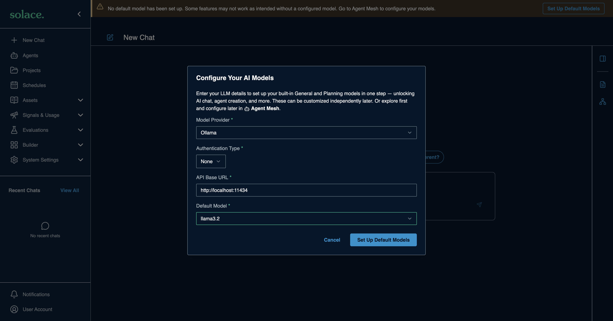
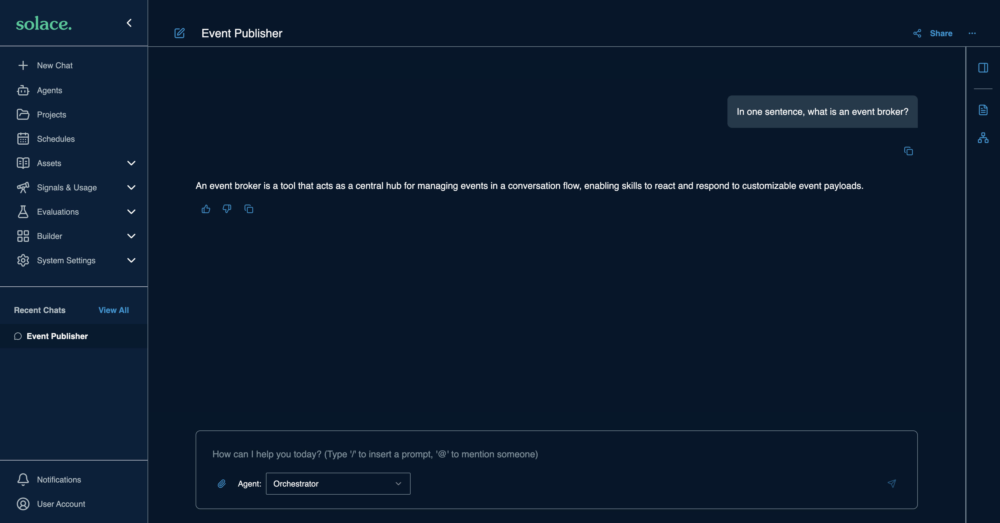
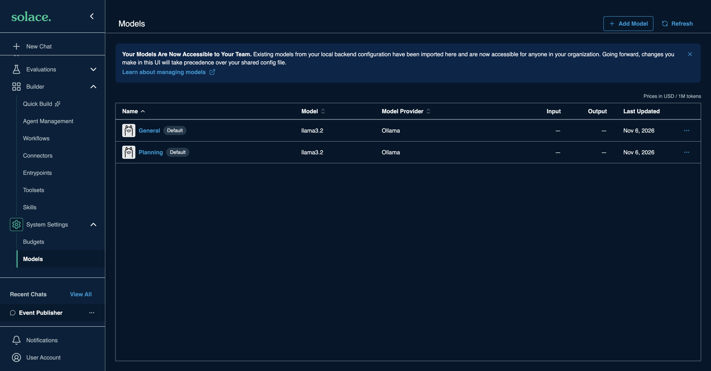

# Ollama for Solace Agent Mesh

> **How this page was made.** Ollama is free and runs on your own machine, so
> this page is tested end to end (install, model, SAM connection, a chat).
> Commands follow Ollama's official documentation, linked at each step.
> The Ollama Cloud section is docs-based only. **Last checked: 2026-11-06.**

**Watch:** [Video 3: Local models with Ollama](https://www.youtube.com/watch?v=G66imk_d6hQ&list=PLD2bQ9LWYU9M) ([transcript](../../videos/transcripts/03-ollama.md))

## At a glance

| | |
|---|---|
| What you need | Ollama installed and one model pulled. No API key for local use. |
| Cost to start | Free (your own hardware) |
| SAM Model Provider | **Ollama** |
| API Base URL | `http://localhost:11434` (see "Where is SAM running?" below) |
| Authentication Type | **None** |
| Example model names | `gpt-oss:20b`, `llama3.2`, `gemma4:e2b` ([library](https://ollama.com/library)) |
| Time | About 10 minutes, mostly the model download |

## Before you start

- Enough memory for the model. Small models need roughly 8 GB of RAM or VRAM;
  larger ones need more. Check the model's page in the library.
- Pick a model that supports **tool calling**. SAM agents call tools, and
  models without it give poor results. The Ollama library tags these as *tools*.

## 1. Install Ollama and pull a model

1. Download and install from <https://ollama.com/download>, then open the app.
   On a Linux server, run `ollama serve` instead.
2. Pull and try a model:

   ```bash
   ollama pull llama3.2
   ollama run llama3.2      # type /bye to exit
   ```

(source: [Quickstart](https://docs.ollama.com/quickstart))

## 2. Check the server works

```bash
curl http://localhost:11434/v1/models
curl http://localhost:11434/v1/chat/completions \
  -H "Content-Type: application/json" \
  -d '{"model": "llama3.2", "messages": [{"role": "user", "content": "Say this is a test"}]}'
```

You should get a model list, then a short JSON reply.

(source: [OpenAI compatibility](https://docs.ollama.com/api/openai-compatibility))

## Where is SAM running?

The API Base URL must be reachable **from SAM**, not just from your browser.

| SAM runs... | API Base URL |
|---|---|
| On the same machine, directly (SAM Desktop, `sam run`) | `http://localhost:11434` |
| In Docker on the same machine | `http://host.docker.internal:11434` |
| In a GitHub Codespace | Your laptop's Ollama is **not** reachable. Run Ollama inside the codespace (needs a large machine) or use another provider. |
| On another machine | `http://<that-machine-ip>:11434`, and start Ollama with `OLLAMA_HOST=0.0.0.0` so it listens on the network |

## 3. Add it to SAM

On a fresh SAM, the **Configure Your AI Models** dialog opens the first time you
open SAM in your browser. If you closed it, the **Set Up Default Models** button in
the banner takes you to **System Settings > Models** instead: edit **General**
(and **Planning**) there with the same values. The dialog sets both in one step.
Enter:

| Field | Value |
|---|---|
| Model Provider | **Ollama** |
| Authentication Type | **None** |
| API Base URL | from the table above, for example `http://localhost:11434` |
| Default Model | pick from the list. SAM reads it from your Ollama server, so you only see models you have pulled. |



Click **Set Up Default Models**. Then send a chat to check it works:



**System Settings > Models** now shows General and Planning on Ollama
(in some SAM versions this page is under **Builder > Models**):



Adding more models later: [the SAM Models form](../../common/sam-model-form.md).

## Troubleshooting

| Symptom | Likely cause | Fix |
|---|---|---|
| Connection refused | Ollama not running, or wrong host for where SAM runs | Open the Ollama app or run `ollama serve`; check the table above |
| Model not found | Model not pulled | `ollama pull <name>`; `ollama list` shows what you have |
| Agent ignores tools or loops | Model has no tool-calling support | Use a model tagged *tools* |
| Very slow replies | Model too big for your hardware | Try a smaller model |

## Ollama Cloud (optional)

Ollama also hosts models. With an ollama.com account, create a key at
<https://ollama.com/settings/keys>, use API Base URL `https://ollama.com`
and Authentication Type **API Key**. This part is based on
[Ollama's cloud docs](https://docs.ollama.com/cloud) and was **not
live-verified**; see [pricing](https://ollama.com/pricing) for limits.

## References

- [Quickstart](https://docs.ollama.com/quickstart)
- [API](https://docs.ollama.com/api)
- [OpenAI compatibility](https://docs.ollama.com/api/openai-compatibility)
- [Cloud](https://docs.ollama.com/cloud)
