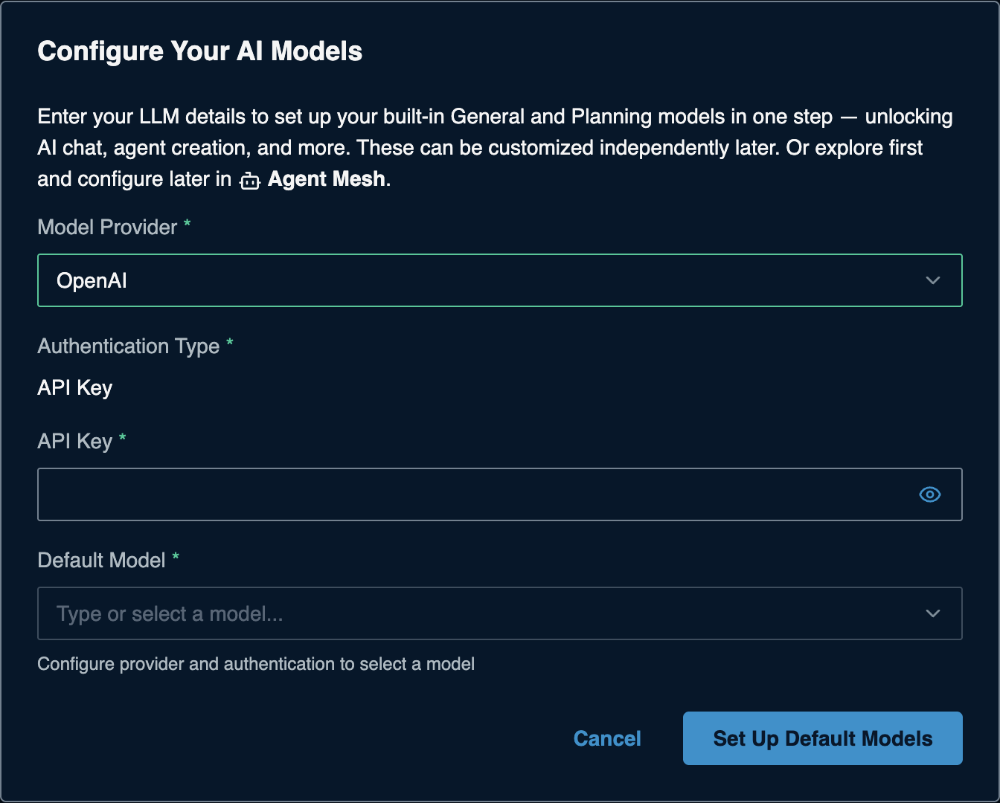

# OpenAI for Solace Agent Mesh

> **How this page was made.** The OpenAI-side steps below are based on OpenAI's
> official documentation, linked at each step. They were **not live-verified** by
> us (we did not create an account). OpenAI's console changes often: if a screen
> looks different, follow the linked page.
> SAM-side steps were captured live from SAM 2.385.1. **Last checked: 2026-11-06.**

**Watch:** [Video 1: API-key providers](https://www.youtube.com/watch?v=atnMfLbcSF4&list=PLD2bQ9LWYU9M) ([transcript](../../videos/transcripts/01-api-key-providers.md))

## At a glance

| | |
|---|---|
| What you need | An OpenAI API key (`sk-...`) |
| Cost to start | Free tier in allowed countries (limited); the first paid tier starts after a $5 credit purchase |
| SAM Model Provider | **OpenAI** |
| API Base URL | Leave empty (default `https://api.openai.com/v1`) |
| Example model names | `gpt-6-luna` (cheapest), `gpt-6.1-terra`, `gpt-6.1-sol` ([full list](https://developers.openai.com/api/docs/models)) |
| Time | About 3 minutes |

## Before you start

- An OpenAI platform account. Sign in at <https://platform.openai.com/>.
- For more than light testing, a payment method and prepaid credits. See
  [Pricing](https://developers.openai.com/api/docs/pricing) and
  [Rate limits and usage tiers](https://developers.openai.com/api/docs/guides/rate-limits).

## 1. Get your API key

1. Open the **API keys** page:
   <https://platform.openai.com/settings/organization/api-keys>.
2. Click **+ Create new secret key**.
3. Give it a name (for example `sam-workshop`), choose the project, and, if
   offered, set an expiration date. OpenAI recommends one.
4. Click **Create secret key** and **copy the key now**. It is shown only once.
   If you lose it, create a new one.

(source: [API keys guide](https://developers.openai.com/api/docs/guides/api-keys),
[Quickstart](https://developers.openai.com/api/docs/quickstart))

## 2. Check the key works (optional)

```bash
export OPENAI_API_KEY="sk-...your-key..."
curl https://api.openai.com/v1/models -H "Authorization: Bearer $OPENAI_API_KEY"
```

A JSON list of models means the key is valid. `401` means the key is wrong or
revoked. Listing models does not use credits.

(source: [API reference: authentication](https://developers.openai.com/api/reference/overview))

## 3. Add it to SAM

On a fresh SAM, the **Configure Your AI Models** dialog opens the first time you
open SAM in your browser. If you closed it, the **Set Up Default Models** button in
the banner takes you to **System Settings > Models** instead: edit **General**
(and **Planning**) there with the same values. Enter:

| Field | Value |
|---|---|
| Model Provider | **OpenAI** |
| Authentication Type | **API Key** (preset) |
| API Key | your `sk-...` key |
| Default Model | pick from the list, for example `gpt-6.1-terra`. The list fills in once the key is accepted. |



Click **Set Up Default Models**. To add OpenAI as an extra model later, use
**System Settings > Models > Add Model**
([the SAM Models form](../../common/sam-model-form.md)).

## Troubleshooting

| Symptom | Likely cause | Fix |
|---|---|---|
| `401 Unauthorized` | Key mistyped, truncated, or revoked | Paste again (use the eye icon to check), or create a new key |
| `429` with *insufficient_quota* | No credits or free limit used up | Add credits under Billing, or wait for the limit to reset |
| Model Name dropdown is empty | Key not accepted yet | Re-enter the key, then reopen the dropdown |
| Model not found | Model not available to your project or tier | Pick another model from the dropdown |

## Keep it safe

- Revoke a key on the same API keys page; revocation takes effect within seconds.
- Keep the key in SAM or in `.env`, never in a file you commit or share.

## References

- [Quickstart](https://developers.openai.com/api/docs/quickstart)
- [API keys guide](https://developers.openai.com/api/docs/guides/api-keys)
- [Models](https://developers.openai.com/api/docs/models)
- [Pricing](https://developers.openai.com/api/docs/pricing)
- [Rate limits and usage tiers](https://developers.openai.com/api/docs/guides/rate-limits)
